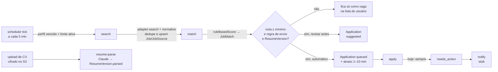

# Visão geral do CV Pilot

> Retrato do projeto em **2026-11-18**: o que já existe, como as peças se conectam e quanto do [PRD](PRD.md) está implementado.
> Para o que falta e o que melhorar, veja [melhorias.md](melhorias.md).

## 1. Em uma frase

O CV Pilot é uma plataforma para o candidato **configurar uma vez** o que procura e quais currículos usar em cada site. A partir daí, bots coletam vagas, dão uma nota de compatibilidade e preparam candidaturas automáticas ou assistidas, que o candidato acompanha num painel.

## 2. Estado atual (resumo)

O projeto está no fim da **Fase 0 (fundação)** do roadmap, com o esqueleto da Fase 1:

- O monorepo, os contratos, o banco, as filas, a infra Docker e o pipeline de workers estão de pé e bem organizados.
- Já há CRUDs e telas para os perfis de busca e as regras de envio (incluindo a precedência perfil+site → site → perfil → padrão, com testes).
- Três adapters de busca funcionam com APIs públicas: Gupy, Greenhouse e Lever.
- **O pipeline já gera candidaturas** (Etapa 1): o candidato envia o currículo (PDF ou DOCX), o arquivo vai cifrado para o S3, o Claude extrai os dados, e o match cria a candidatura com a regra de envio do site.
- **Ainda faltam peças centrais:**
  - todo envio termina em "Ação necessária" (modos API e e-mail e a extensão não existem);
  - não há login: em dev, a API aceita um usuário de desenvolvimento com `AUTH_DEV_BYPASS=true`;
  - o matching é só por regras (sem embeddings).
- Qualidade: `pnpm check` (typecheck, ESLint, knip e testes de unidade) e `pnpm test:integration` (Postgres e Redis reais) passam, e a CI roda os dois.
- Versionado em Git, com remoto no GitHub (`gabrielAlencar33564/cv-pilot`).

## 3. Arquitetura

### 3.1 Serviços

| Serviço     | Tecnologia                                           | Papel                                                                                                                 | Código                                                         |
| ----------- | ---------------------------------------------------- | --------------------------------------------------------------------------------------------------------------------- | -------------------------------------------------------------- |
| `web`       | Next.js 15 (App Router) + Mantine 8 + TanStack Query | Interface do candidato                                                                                                | [apps/web](../apps/web)                                        |
| `api`       | Fastify 5 + Zod + Prisma                             | REST para o front e, no futuro, para a extensão                                                                       | [apps/api](../apps/api)                                        |
| `workers`   | BullMQ + pino                                        | Agendamento, busca, matching, envio, notificações, extração de CV                                                     | [apps/workers](../apps/workers)                                |
| `extension` | (planejada) Chrome MV3                               | Modo assistido: preenche o formulário, e o candidato envia                                                            | [apps/extension](../apps/extension)                            |
| `postgres`  | PostgreSQL 16 + pgvector                             | Dados relacionais e embeddings                                                                                        | [schema.prisma](../packages/db/prisma/schema.prisma)           |
| `redis`     | Redis 7                                              | Filas BullMQ                                                                                                          | —                                                              |
| `s3`        | SeaweedFS (gateway S3)                               | Arquivos de currículo. O entrypoint cria o bucket `resumes`, e a identidade das apps só lê, grava e lista esse bucket | [s3-entrypoint.sh](../infra/docker/seaweedfs/s3-entrypoint.sh) |
| `caddy`     | Caddy 2                                              | HTTPS e proxy (`/api/*` → api, resto → web)                                                                           | [Caddyfile](../infra/docker/caddy/Caddyfile)                   |

### 3.2 Pacotes internos

| Pacote                                      | Responsabilidade                                                                                                                         | Observação                                                                                                           |
| ------------------------------------------- | ---------------------------------------------------------------------------------------------------------------------------------------- | -------------------------------------------------------------------------------------------------------------------- |
| [`contracts`](../packages/contracts/src)    | Schemas Zod compartilhados (enums, perfil de busca, regra de envio, vaga normalizada)                                                    | Fonte única dos tipos. O `web` ainda duplica parte deles em [types.ts](../apps/web/src/lib/types.ts)                 |
| [`core`](../packages/core/src)              | Regras puras: `resolveSendRule`, `jobDedupeHash`, `ruleBasedScore`                                                                       | Sem dependência de framework                                                                                         |
| [`db`](../packages/db)                      | Schema Prisma, migrations, client único e seed                                                                                           | Migrations `init` e `embeddings_1024_and_search_indexes` (SQL manual: `NULLS NOT DISTINCT`, HNSW e GIN de full-text) |
| [`queue`](../packages/queue/src/index.ts)   | Nomes das filas, tipos de payload, conexão Redis, `enqueue`                                                                              | Retentativas: 4, backoff exponencial de 30 s. Exige `REDIS_URL` (sem endereço padrão)                                |
| [`adapters`](../packages/adapters/src)      | Um adapter por site + `createPoliteFetch` (User-Agent identificado, timeout, vez de cada host injetada pelo worker, 403/429 tipados)     | Gupy (busca por palavra-chave), Greenhouse e Lever (por empresa, via `Source.config`)                                |
| [`ai`](../packages/ai/src/index.ts)         | Interface `AiProvider` (por enquanto só extração de CV)                                                                                  | `ClaudeAiProvider` (`claude-opus-5-5`, saída estruturada) e `noop`, escolhidos por `AI_PROVIDER`                     |
| [`logger`](../packages/logger/src/index.ts) | pino compartilhado: JSON em produção, legível em dev, mascaramento de dados pessoais, contexto por job (`withLogContext`), falhas fatais | Usado pela API (Fastify) e pelos workers                                                                             |
| [`storage`](../packages/storage/src)        | Arquivos de currículo no S3: chave do objeto gerada no servidor e AES-256-GCM com `ENCRYPTION_KEY`                                       | Usado pela API (upload) e pelo `resume-parse` ([ADR 0002](adr/0002-criptografia-de-curriculos.md))                   |
| [`config`](../packages/config)              | tsconfig base / node / next (strict, `noUncheckedIndexedAccess`, `noUnusedLocals`, `noUnusedParameters`)                                 | ESLint e knip ficam na raiz ([eslint.config.mjs](../eslint.config.mjs), [knip.json](../knip.json))                   |

### 3.3 Fluxo do pipeline



Pontos importantes:

- **Idempotência.** Os jobs usam ids determinísticos (`search_{perfil}_{fonte}_{janela}`, `match_{vaga}_{perfil}`, `apply_{candidatura}`).
- **Escala por fila.** Cada réplica escolhe o que consome via `WORKER_QUEUES`. No compose de produção, `workers-scheduler` roda `scheduler,notify` e `workers` roda `search,match,apply,resume-parse`.
- **Bloqueios.** Num 403, a fonte é pausada (`Source.active = false`) e o job não repete; num 429, o job é adiado pelo `Retry-After`. O bot nunca tenta contornar o bloqueio, e os erros ficam em `Source.lastError`.
- **Limites.** O intervalo entre requisições ao mesmo host vale para todas as réplicas juntas (Redis). O limite diário de envios automáticos é por usuário e por fonte, no fuso do usuário (contador atômico no Redis).

### 3.4 Modelo de dados

```
User ─┬─< SearchProfile ──< JobMatch >── Job ──< JobSource >── Source
      ├─< Resume ──< ResumeVersion (storageKey, parsed, parseStatus, embedding vector(1024))
      ├─< CoverLetterTemplate
      ├─< SendRule (sourceId?, searchProfileId?, resumeId, tom, modo, defaultAnswers)
      ├─< Application (job, source, resumeVersion, status, answers, log[])
      ├─< OAuthConnection (tokens criptografados — ainda não usada)
      └─< ConsentLog
```

Status de candidatura (`contracts/enums.ts`): `suggested`, `queued`, `needs_action`, `sent`, `in_process`, `interview`, `offer`, `rejected`, `no_response`, `failed`.

### 3.5 API REST atual

| Rota                                                                        | O que faz                                                                              |
| --------------------------------------------------------------------------- | -------------------------------------------------------------------------------------- |
| `GET /health`, `GET /health/ready`                                          | Liveness e readiness (Postgres + Redis)                                                |
| `GET /sources`                                                              | Fontes ativas                                                                          |
| `GET/POST/PUT/DELETE /search-profiles`, `PATCH /search-profiles/:id/active` | CRUD de perfis de busca                                                                |
| `GET/POST /resumes`, `POST /resumes/:id/versions`                           | Lista e cria currículos; upload de PDF/DOCX (multipart, até 5 MB) gera uma nova versão |
| `GET/POST/PUT/DELETE /send-rules`, `GET /send-rules/resolve`                | CRUD de regras e qual regra vale para um site/perfil                                   |
| `GET /jobs`                                                                 | Vagas compatíveis, paginadas e ordenadas pela nota                                     |
| `GET /applications`, `PATCH /applications/:id`                              | Painel e atualização manual de status/notas                                            |

### 3.6 Telas atuais

Início · O que estou buscando · Currículos (upload e status da extração) · Envio por site · Vagas (somente leitura) · Candidaturas (kanban somente leitura com 6 colunas).

## 4. Cobertura do PRD

Legenda: ✅ feito · 🟡 parcial · ❌ não iniciado

| Área (PRD)                                | Status | O que existe / o que falta                                                                                                                                                                                                                                                |
| ----------------------------------------- | ------ | ------------------------------------------------------------------------------------------------------------------------------------------------------------------------------------------------------------------------------------------------------------------------- |
| 3.1 Conta e perfil (RF-01–04)             | ❌     | Bypass de dev só com `AUTH_DEV_BYPASS=true` (a API recusa subir com ele em produção). Sem login, perfil, consentimento, exportação ou exclusão                                                                                                                            |
| 3.2 Perfis de busca (RF-10–12)            | 🟡     | CRUD e pausar/retomar. Falta duplicar. O formulário não expõe contrato, salário, blacklist nem frequência                                                                                                                                                                 |
| 3.3 Currículos (RF-20, 21, 24, 25)        | 🟡     | Upload de PDF/DOCX validado pelo conteúdo, versionamento e extração por IA (`claude-opus-5-5`) com status na tela. Falta o candidato revisar e corrigir os dados extraídos (RF-21) e a pré-visualização (RF-24)                                                           |
| 3.3 Regras por site (RF-22, 23)           | ✅/🟡  | CRUD e precedência testada. Falta CRUD de modelos de carta e edição de `defaultAnswers` na UI                                                                                                                                                                             |
| 3.4 Busca (RF-30–35)                      | 🟡     | 3 adapters, scheduler e dedupe. Falta expirar vagas (RF-34) e o admin de fontes (RF-35)                                                                                                                                                                                   |
| 3.5 Matching (RF-40–42)                   | 🟡     | Nota por palavras-chave com termo inteiro (sem acentos; `c#`, `node.js`) e regras rígidas de modelo, senioridade, contrato, salário e local. Sem embeddings, "o que falta" e "não tenho interesse". As colunas `vector(1024)` e os índices HNSW e GIN já existem, sem uso |
| 3.6 Envio (RF-50–54)                      | 🟡     | Fila com atraso aleatório e limite diário real por usuário e fonte, no fuso do usuário. Os modos API e e-mail não existem; assistido depende da extensão                                                                                                                  |
| 3.7 Painel (RF-60–63)                     | 🟡     | Kanban só leitura. Sem mudança de status na UI, sem notas e sem métricas                                                                                                                                                                                                  |
| 3.8 Notificações (RF-70–71)               | ❌     | Processor `notify` é stub                                                                                                                                                                                                                                                 |
| 3.9 Administração (RF-80–81)              | ❌     | Só `Source.lastRunAt/lastError`                                                                                                                                                                                                                                           |
| RNF-01/02 TypeScript strict, pnpm + Turbo | ✅     | `typecheck`, `test`, `build` e `dev` esperam o Prisma Client ser gerado                                                                                                                                                                                                   |
| RNF-03/04 Docker, serviços separados      | ✅     | Multi-stage, `turbo prune`, cache mount, réplicas por fila. Falta `workers-browser`                                                                                                                                                                                       |
| RNF-05 LGPD                               | 🟡     | Currículos cifrados com AES-256-GCM (`ENCRYPTION_KEY`) antes do S3, nome do arquivo mascarado nos logs. Faltam tokens OAuth cifrados, consentimento, retenção e exclusão de conta                                                                                         |
| RNF-06 Conformidade com sites             | 🟡     | UA identificado e intervalo por host somando todas as réplicas (Redis); 403 pausa a fonte. Falta `robots.txt`                                                                                                                                                             |
| RNF-07 Resiliência                        | 🟡     | Retentativas, jobs idempotentes, 429 adia o job pelo `Retry-After` e falha definitiva não repete. Sem DLQ visível nem alerta                                                                                                                                              |
| RNF-08 Observabilidade                    | 🟡     | Logs estruturados (pino) compartilhados entre API e workers, com contexto por job, stack de erros e rotação no Docker; health da API e healthcheck do `s3`. Workers sem healthcheck, sem métricas por adapter e sem alertas                                               |
| RNF-10 Testes                             | 🟡     | 124 testes de unidade e 19 de integração (rotas da API com Postgres de teste, contador no Redis), incluindo contratos de Gupy, Greenhouse e Lever. A CI ([ci.yml](../.github/workflows/ci.yml)) roda `pnpm check` e `pnpm test:integration`. Sem e2e                      |

## 5. Como rodar

```bash
pnpm install
cp .env.example .env
pnpm infra:up        # Postgres :5433, Redis :6380 e S3/SeaweedFS :8333
pnpm db:deploy       # aplica as migrations versionadas
pnpm db:seed         # fontes + usuário dev
pnpm dev             # web :3000, api :4000, workers
```

Para que o Greenhouse e o Lever encontrem vagas, preencha `Source.config` (`{"boards": [...]}` e `{"companies": [...]}`). O seed não faz isso.

Verificação completa: `pnpm check` (Prisma generate, typecheck, lint, knip e testes).
