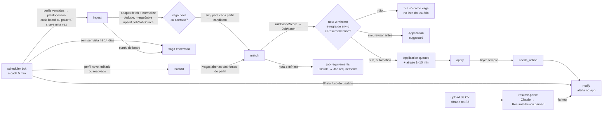

# Visão geral do CV Pilot

> Retrato do projeto em **2026-11-19**: o que já existe, como as peças se conectam e quanto do [PRD](PRD.md) está implementado.
> Para o que falta e o que melhorar, veja [melhorias.md](melhorias.md).

## 1. Em uma frase

O CV Pilot é uma plataforma para o candidato **configurar uma vez** o que procura e quais currículos usar em cada site. A partir daí, bots coletam vagas, dão uma nota de compatibilidade e preparam candidaturas automáticas ou assistidas, que o candidato acompanha num painel.

## 2. Estado atual (resumo)

A **Fase 0 (fundação)** do roadmap está pronta, e a **Fase 1 (MVP)** está quase completa: falta o envio por e-mail (OAuth Gmail).

- O monorepo, os contratos, o banco, as filas, a infra Docker e o pipeline de workers estão de pé e bem organizados.
- Já há CRUDs e telas para os perfis de busca e as regras de envio (incluindo a precedência perfil+site → site → perfil → padrão, com testes).
- Cinco adapters de busca: Gupy, Greenhouse e Lever por API pública; Nerdin e ProgramaThor por HTML, com a listagem lida inteira e o JSON-LD de cada vaga nova ([ADR 0004](adr/0004-fontes-html-feed-e-detalhe.md)).
- **A coleta é desacoplada dos perfis** (início da Etapa 3): cada board do catálogo de empresas (`CareerBoard`) ou palavra-chave é baixado uma vez para todos os usuários, e só as vagas novas ou alteradas vão para o match. As vagas que somem do board ou que ninguém vê há 14 dias são encerradas (RF-34).
- **O pipeline já gera candidaturas** (Etapa 1): o candidato envia o currículo (PDF ou DOCX), o arquivo vai cifrado para o S3, o Claude extrai os dados, e o match cria a candidatura com a regra de envio do site.
- **Dá para usar sozinho** (Etapa 2):
  - login por e-mail e senha (Better Auth), aceite dos termos, exportação e exclusão de conta;
  - onboarding que sugere perfis de busca a partir do currículo;
  - ações nas vagas (detalhes com o "o que falta", pré-visualizar, candidatar, "não tenho interesse");
  - kanban com troca de status e anotações, modelos de carta e alertas dentro do app;
- **Ainda faltam peças centrais:**
  - todo envio termina em "Ação necessária" (modos API e e-mail e a extensão não existem);
  - nada sai por e-mail: os alertas ficam no app, e não há verificação de e-mail nem "esqueci a senha";
  - os termos de uso e a política de privacidade são um rascunho, sem revisão jurídica.
- Qualidade: `pnpm check` (typecheck, ESLint, knip e testes de unidade), `pnpm test:integration` (Postgres e Redis reais) e `pnpm test:e2e` (Playwright) passam, e a CI roda os três.
- Versionado em Git, com remoto no GitHub (`gabrielAlencar33564/cv-pilot`).

## 3. Arquitetura

### 3.1 Serviços

| Serviço     | Tecnologia                                           | Papel                                                                                                                 | Código                                                         |
| ----------- | ---------------------------------------------------- | --------------------------------------------------------------------------------------------------------------------- | -------------------------------------------------------------- |
| `web`       | Next.js 15 (App Router) + Mantine 8 + TanStack Query | Interface do candidato                                                                                                | [apps/web](../apps/web)                                        |
| `api`       | Fastify 5 + Zod + Prisma                             | REST para o front e, no futuro, para a extensão                                                                       | [apps/api](../apps/api)                                        |
| `workers`   | BullMQ + pino                                        | Agendamento, busca, matching, envio, notificações, extração de CV                                                     | [apps/workers](../apps/workers)                                |
| `extension` | (planejada) Chrome MV3                               | Modo assistido: preenche o formulário, e o candidato envia                                                            | [apps/extension](../apps/extension)                            |
| `postgres`  | PostgreSQL 16 + pgvector                             | Dados relacionais e embeddings                                                                                        | [schema.prisma](../packages/db/prisma/schema.prisma)           |
| `redis`     | Redis 7                                              | Filas BullMQ                                                                                                          | —                                                              |
| `s3`        | SeaweedFS (gateway S3)                               | Arquivos de currículo. O entrypoint cria o bucket `resumes`, e a identidade das apps só lê, grava e lista esse bucket | [s3-entrypoint.sh](../infra/docker/seaweedfs/s3-entrypoint.sh) |
| `caddy`     | Caddy 2                                              | HTTPS e proxy (`/api/*` → api, resto → web)                                                                           | [Caddyfile](../infra/docker/caddy/Caddyfile)                   |

### 3.2 Pacotes internos

| Pacote                                      | Responsabilidade                                                                                                                                                                                      | Observação                                                                                                                                                                                                                                                 |
| ------------------------------------------- | ----------------------------------------------------------------------------------------------------------------------------------------------------------------------------------------------------- | ---------------------------------------------------------------------------------------------------------------------------------------------------------------------------------------------------------------------------------------------------------- |
| [`contracts`](../packages/contracts/src)    | Schemas Zod compartilhados (enums, perfil de busca, regra de envio, vaga normalizada, conta, termos, candidatura, modelos de carta, alertas)                                                          | Fonte única dos tipos. O `web` ainda duplica parte deles em [types.ts](../apps/web/src/lib/types.ts)                                                                                                                                                       |
| [`core`](../packages/core/src)              | Regras puras: `resolveSendRule`, `jobDedupeHash`, `mergeJob`, `ruleBasedScore`, `isMatchCandidate`, `planIngestion`, `dailyBucket`, `manualTransitions`, `renderCoverLetter`, `suggestSearchProfiles` | Sem dependência de framework                                                                                                                                                                                                                               |
| [`db`](../packages/db)                      | Schema Prisma, migrations, client único e seed                                                                                                                                                        | SQL manual na migration `embeddings_1024_and_search_indexes` (`NULLS NOT DISTINCT`, HNSW e GIN de full-text)                                                                                                                                               |
| [`queue`](../packages/queue/src/index.ts)   | Nomes das filas, tipos de payload, conexão Redis, `enqueue`, `enqueueApplication` e o limite diário (`reserveDailySlot`)                                                                              | Retentativas: 4, backoff exponencial de 30 s. Exige `REDIS_URL` (sem endereço padrão)                                                                                                                                                                      |
| [`adapters`](../packages/adapters/src)      | Um adapter por site + `createPoliteFetch` (User-Agent identificado, timeout, `robots.txt`, vez de cada host e cache do `robots.txt` injetados pelo worker, 403/429/robots tipados)                    | Gupy e Solides (`fetchBy: 'keyword'`; a Solides pelo MCP oficial), Greenhouse, Lever e TOTVS (`fetchBy: 'board'`, um `CareerBoard` por vez), Nerdin e ProgramaThor (`fetchBy: 'feed'`). Os sites HTML leem o JSON-LD e baixam o detalhe só das vagas novas |
| [`ai`](../packages/ai/src/index.ts)         | Interface `AiProvider`: extração de CV, requisitos da vaga, cartas e embeddings                                                                                                                       | `claude`: Claude (`claude-opus-5-5`) nas extrações e Voyage (`voyage-4`, HTTP direto) nos embeddings; `noop` sem nenhum dos dois. Escolhido por `AI_PROVIDER`                                                                                              |
| [`logger`](../packages/logger/src/index.ts) | pino compartilhado: JSON em produção, legível em dev, mascaramento de dados pessoais, contexto por job (`withLogContext`), falhas fatais                                                              | Usado pela API (Fastify) e pelos workers                                                                                                                                                                                                                   |
| [`storage`](../packages/storage/src)        | Arquivos de currículo no S3: chave do objeto gerada no servidor e AES-256-GCM com `ENCRYPTION_KEY`                                                                                                    | Usado pela API (upload) e pelo `resume-parse` ([ADR 0002](adr/0002-criptografia-de-curriculos.md))                                                                                                                                                         |
| [`config`](../packages/config)              | tsconfig base / node / next (strict, `noUncheckedIndexedAccess`, `noUnusedLocals`, `noUnusedParameters`)                                                                                              | ESLint e knip ficam na raiz ([eslint.config.mjs](../eslint.config.mjs), [knip.json](../knip.json))                                                                                                                                                         |

### 3.3 Fluxo do pipeline



Pontos importantes:

- **Coleta compartilhada.** O scheduler junta os perfis cuja busca venceu e monta os alvos (`planIngestion`): nas fontes por empresa, cada board ativo do catálogo; nas de busca, cada palavra-chave normalizada. Dez usuários buscando "react" na Gupy geram uma consulta. O `ingest` grava as vagas e manda para o `match` só as novas, alteradas, vistas numa fonte nova ou reabertas, e só para os perfis que podem casar com elas (`isMatchCandidate`: alguma palavra-chave e nenhuma regra rígida contra). O perfil novo, editado ou reativado volta a ter `lastSearchedAt` vazio, e o `backfill` o compara com as vagas que já estavam no banco.
- **Expiração (RF-34).** Depois de baixar um board inteiro, as vagas dele que não vieram são encerradas (`JobSource.closedAt`). Com a lista cortada no teto (1.000 vagas), nada é encerrado. Uma fonte de vaga que ninguém vê há 14 dias também fecha, e a vaga sem nenhuma fonte aberta fica `active = false`. Se reaparecer, ela reabre.
- **Idempotência.** Os jobs usam ids determinísticos com janela de 1 h (`ingest_{fonte}_{board ou hash da palavra}_{janela}`, `backfill_{perfil}_{janela}`, `match_{vaga}_{perfil}_{janela}`) e também `apply_{candidatura}`, `requirements_{vaga}_{hash do texto}`, `company_detect_{sugestão}`, `cover_letter_{candidatura}` e `notify_new_jobs_{usuário}_{dia}`. Cada alerta também tem uma chave única por usuário (`Notification.dedupeKey`).
- **Escala por fila.** Cada réplica escolhe o que consome via `WORKER_QUEUES`. No compose de produção, `workers-scheduler` roda `scheduler,notify` e `workers` roda `ingest,backfill,match,apply,resume-parse,job-requirements,company-detect,cover-letter`.
- **`robots.txt` (RNF-06).** O fetch educado lê o `robots.txt` de cada origem antes da primeira requisição e o guarda no Redis por 24 h. Ele usa o grupo `CVPilotBot` ou o `*`, e vence a regra mais longa. Sem `robots.txt` (4xx), nada é proibido; com ele fora do ar (5xx ou falha de rede), nada é acessado, e o job tenta de novo mais tarde. Caminho proibido vira `SourceDisallowedError`.
- **Bloqueios.** Num 403 ou num caminho proibido pelo `robots.txt`, a fonte é pausada (`Source.active = false`) e o job não repete; num 429, o job é adiado pelo `Retry-After`. O bot nunca tenta contornar o bloqueio, e os erros ficam em `Source.lastError`.
- **Limites.** O intervalo entre requisições ao mesmo host vale para todas as réplicas juntas (Redis). O limite diário de envios automáticos é por usuário e por fonte, no fuso do usuário (contador atômico no Redis).

### 3.4 Modelo de dados

```
User ─┬─< SearchProfile ──< JobMatch >── Job ──< JobSource (closedAt) >── Source ──< CareerBoard
      │                                              └──────────── careerBoardId ───────┘
      ├─< Resume ──< ResumeVersion (storageKey, parsed, parseStatus, embedding vector(1024))
      ├─< CoverLetterTemplate
      ├─< SendRule (sourceId?, searchProfileId?, resumeId, tom, modo, defaultAnswers)
      ├─< Application (job, source, resumeVersion, status, coverLetter, answers, notes, log[])
      ├─< Notification (kind, data só com ids, dedupeKey, readAt)
      ├─< Session, Account (Better Auth: sessões e hash da senha)
      ├─< OAuthConnection (tokens criptografados — ainda não usada)
      └─< ConsentLog (versão dos termos, data, IP)
```

Status de candidatura (`contracts/enums.ts`): `suggested`, `queued`, `needs_action`, `sent`, `in_process`, `interview`, `offer`, `rejected`, `no_response`, `failed`. As mudanças manuais permitidas estão em [application-status.ts](../packages/core/src/application-status.ts).

### 3.5 API REST atual

| Rota                                                                                                                    | O que faz                                                                                                               |
| ----------------------------------------------------------------------------------------------------------------------- | ----------------------------------------------------------------------------------------------------------------------- |
| `GET /health`, `GET /health/ready`                                                                                      | Liveness e readiness (Postgres + Redis). Públicas                                                                       |
| `/auth/*`                                                                                                               | Better Auth: cadastro, entrar, sair, sessão, troca de senha, excluir conta (pede a senha). Públicas                     |
| `GET/PATCH /me`, `GET /me/export`, `POST /me/consents`                                                                  | Perfil base, exportação de todos os dados (JSON) e aceite dos termos. Funcionam sem o aceite                            |
| `GET /sources`                                                                                                          | Fontes ativas                                                                                                           |
| `GET/POST/PUT/DELETE /search-profiles`, `PATCH /search-profiles/:id/active`                                             | CRUD de perfis de busca                                                                                                 |
| `GET/POST /resumes`, `POST /resumes/:id/versions`                                                                       | Lista e cria currículos; upload de PDF/DOCX (multipart, até 5 MB) gera uma nova versão                                  |
| `GET /resumes/:id/versions/:versionId/file`                                                                             | O arquivo decifrado, só para o dono                                                                                     |
| `GET /resumes/:id/profile-suggestions`                                                                                  | Perfis de busca sugeridos pelos dados extraídos (onboarding)                                                            |
| `GET/POST/PUT/DELETE /send-rules`, `GET /send-rules/resolve`                                                            | CRUD de regras e qual regra vale para um site/perfil                                                                    |
| `GET/POST/PUT/DELETE /cover-letter-templates`                                                                           | Modelos de carta com `{{empresa}}`, `{{cargo}}` e `{{nome}}`                                                            |
| `GET /jobs`, `GET /jobs/:id`                                                                                            | Vagas compatíveis, paginadas e ordenadas pela nota; detalhes com a pré-visualização do envio                            |
| `POST /jobs/:id/apply`, `POST /jobs/:id/dismiss`                                                                        | Candidatar-se (respeita o limite diário) e "não tenho interesse" (motivo e, se pedido, empresa excluída)                |
| `GET /applications`, `PATCH /applications/:id`                                                                          | Painel com as transições permitidas; mudança de status (409 fora da máquina de estados) e anotações                     |
| `GET /admin/sources`, `PATCH /admin/sources/:id`, `GET /admin/sources/:id/runs`                                         | Só ADMIN: saúde das fontes nas últimas 24 h, ligar e desligar e ajustar o limite (RF-35, RF-81), histórico de execuções |
| `GET/POST /admin/career-boards`, `PATCH /admin/career-boards/:id`                                                       | Só ADMIN: catálogo de empresas das fontes por empresa (Greenhouse, Lever)                                               |
| `/admin/queues`                                                                                                         | Só ADMIN: Bull Board, com filas pendentes, falhas, retentativas e o botão de reexecutar (RF-80/81)                      |
| `GET /notifications`, `GET /notifications/unread-count`, `POST /notifications/read-all`, `POST /notifications/:id/read` | Alertas no app e contador de não lidos                                                                                  |
| `GET/POST /company-suggestions`                                                                                         | "Adicionar empresa": a página de carreiras vai para o detector de ATS no worker (até 20 por dia)                        |

Sem sessão, toda rota fora das públicas responde 401. Com os termos desatualizados, responde 403 `consent_required`, menos as de `/me`. As rotas `/admin` respondem 404 para quem não tem o papel `ADMIN`, lido no banco a cada requisição.

### 3.6 Telas atuais

- **Sem login:** Entrar · Cadastro (com aceite dos termos) · Termos (rascunho) · Aceite (quando os termos mudam).
- **Logado:**
  - Início: onboarding para quem não tem perfil (currículo → perfis sugeridos → sites);
  - O que estou buscando: perfis completos, editar e duplicar;
  - Currículos: upload e status da extração;
  - Envio por site: regras com modelo de carta e respostas padrão;
  - Modelos de carta;
  - Vagas: detalhes, pré-visualização, candidatar e "não tenho interesse";
  - Candidaturas: kanban com todas as etapas, "Encerradas", mudança de status, anotações e carta (com a origem: modelo, IA ou editada; editável até o envio);
  - Alertas, com contador no menu;
  - Minha conta: perfil base, troca de senha, exportação e exclusão.
- **Só ADMIN** (`/admin`, com item no menu só para quem tem o papel): fontes com a saúde das últimas 24 h, execuções e erros, ligar e desligar com confirmação, limite de requisições, catálogo de empresas e link para o Bull Board.

## 4. Cobertura do PRD

Legenda: ✅ feito · 🟡 parcial · ❌ não iniciado

| Área (PRD)                                | Status | O que existe / o que falta                                                                                                                                                                                                                                                                                                                                                                                                                                                                                                                                                                                                                                                                              |
| ----------------------------------------- | ------ | ------------------------------------------------------------------------------------------------------------------------------------------------------------------------------------------------------------------------------------------------------------------------------------------------------------------------------------------------------------------------------------------------------------------------------------------------------------------------------------------------------------------------------------------------------------------------------------------------------------------------------------------------------------------------------------------------------- |
| 3.1 Conta e perfil (RF-01–04)             | ✅/🟡  | Login por e-mail e senha (Better Auth, sessão em cookie `httpOnly`), perfil base, aceite versionado dos termos (`ConsentLog`), exportação em JSON e exclusão imediata com a senha (apaga os arquivos no S3). Falta login com Google, verificação de e-mail e "esqueci a senha" (dependem de envio de e-mail), e a revisão jurídica dos termos                                                                                                                                                                                                                                                                                                                                                           |
| 3.2 Perfis de busca (RF-10–12)            | ✅     | CRUD completo (contrato, faixa salarial, empresas excluídas, frequência), editar, duplicar e pausar/retomar. O onboarding sugere perfis a partir do currículo                                                                                                                                                                                                                                                                                                                                                                                                                                                                                                                                           |
| 3.3 Currículos (RF-20, 21, 24, 25)        | 🟡     | Upload de PDF/DOCX validado pelo conteúdo, versionamento e extração por IA (`claude-opus-5-5`) com status na tela. Pré-visualização do arquivo decifrado na vaga (RF-24). Falta o candidato revisar e corrigir os dados extraídos (RF-21)                                                                                                                                                                                                                                                                                                                                                                                                                                                               |
| 3.3 Regras por site (RF-22, 23)           | ✅     | CRUD com edição, precedência testada, editor de respostas padrão e modelos de carta preenchidos com empresa, cargo e nome. A regra pode pedir a carta escrita pela IA (RF-54, abaixo)                                                                                                                                                                                                                                                                                                                                                                                                                                                                                                                   |
| 3.4 Busca (RF-30–35)                      | 🟡     | 7 adapters (4 por API, um deles pelo MCP oficial da Solides, e 3 por HTML com JSON-LD), scheduler, dedupe com merge dos campos entre fontes, coleta compartilhada por board/palavra-chave (catálogo `CareerBoard`) e expiração de vagas (RF-34). O catálogo cresce pelo "Adicionar empresa": o candidato cola a página de carreiras, e o detector reconhece o ATS e confere o board ([ADR 0007](adr/0007-adicionar-empresa-detector-de-ats.md)). Falta o admin de fontes e do catálogo (RF-35)                                                                                                                                                                                                          |
| 3.5 Matching (RF-40–42)                   | 🟡     | Nota das regras (palavras-chave com termo inteiro, sem acentos; regras rígidas de modelo, senioridade, contrato, salário e local) combinada com a semelhança entre os embeddings da vaga e do currículo (Voyage `voyage-4`, cosseno no pgvector, 60/40), gerados sob demanda no match ([ADR 0005](adr/0005-matching-semantico-sob-demanda.md)). Os motivos dizem a semelhança e as habilidades do currículo na vaga. O detalhe mostra o "o que falta" (RF-41): requisitos extraídos pelo Claude uma vez por vaga, para as que passam da nota mínima, e comparados com o currículo sem IA ([ADR 0006](adr/0006-requisitos-da-vaga-por-ia.md)). "Não tenho interesse" com motivo. Falta calibrar os pesos |
| 3.6 Envio (RF-50–54)                      | 🟡     | Candidatar pela lista de vagas ou automaticamente pelo match, com atraso aleatório e limite diário real por usuário e fonte, no fuso do usuário. A carta vai na candidatura: o modelo preenchido ou, com a opção na regra, escrita pelo Claude no worker, no tom da regra e só com fatos do currículo, com o modelo de reserva; o candidato edita no kanban até o envio (RF-54, [ADR 0009](adr/0009-cartas-por-ia-no-worker.md)). Os modos API e e-mail não existem; assistido depende da extensão                                                                                                                                                                                                      |
| 3.7 Painel (RF-60–63)                     | 🟡     | Kanban com todas as etapas e "Encerradas", mudança de status pela máquina de estados (histórico no `log`), anotações e carta para copiar. Faltam métricas (RF-63)                                                                                                                                                                                                                                                                                                                                                                                                                                                                                                                                       |
| 3.8 Notificações (RF-70–71)               | 🟡     | Alertas no app (`/alertas`, contador no menu): resumo diário de vagas novas às 8h no fuso do usuário, "ação necessária" e falha na leitura do currículo. O e-mail foi adiado                                                                                                                                                                                                                                                                                                                                                                                                                                                                                                                            |
| 3.9 Administração (RF-80–81)              | ✅     | Painel `/admin`: saúde de cada fonte nas últimas 24 h (`SourceRun`, uma linha por tentativa de ingestão, guardada por 30 dias), vagas lidas e abertas, execuções com o erro, ligar e desligar sem deploy, limite de requisições e catálogo de empresas. Bull Board em `/admin/queues` para filas, falhas e reexecução                                                                                                                                                                                                                                                                                                                                                                                   |
| RNF-01/02 TypeScript strict, pnpm + Turbo | ✅     | `typecheck`, `test`, `build` e `dev` esperam o Prisma Client ser gerado                                                                                                                                                                                                                                                                                                                                                                                                                                                                                                                                                                                                                                 |
| RNF-03/04 Docker, serviços separados      | ✅     | Multi-stage, `turbo prune`, cache mount, réplicas por fila. Falta `workers-browser`                                                                                                                                                                                                                                                                                                                                                                                                                                                                                                                                                                                                                     |
| RNF-05 LGPD                               | 🟡     | Currículos cifrados com AES-256-GCM (`ENCRYPTION_KEY`) antes do S3, dados pessoais mascarados nos logs, aceite versionado, exportação e exclusão de conta. Faltam tokens OAuth cifrados e a retenção configurável                                                                                                                                                                                                                                                                                                                                                                                                                                                                                       |
| RNF-06 Conformidade com sites             | 🟡     | UA identificado, intervalo por host somando todas as réplicas (Redis) e `robots.txt` conferido antes de cada requisição (RFC 9309, cache de 24 h no Redis); 403 ou caminho proibido pelo `robots.txt` pausa a fonte. `Crawl-delay` não é lido: o intervalo da fonte (`rateLimitMs`/`rateLimitReqs`) precisa ser maior ou igual. Termos de cada site em [fontes/](fontes/README.md); falta confirmar por escrito os da Gupy                                                                                                                                                                                                                                                                              |
| RNF-07 Resiliência                        | 🟡     | Retentativas, jobs idempotentes, 429 adia o job pelo `Retry-After` e falha definitiva não repete. Falhas visíveis e reexecutáveis no Bull Board; ainda sem alerta automático                                                                                                                                                                                                                                                                                                                                                                                                                                                                                                                            |
| RNF-08 Observabilidade                    | 🟡     | Logs estruturados (pino) compartilhados entre API e workers, com contexto por job, stack de erros e rotação no Docker; health da API e healthcheck do `s3`. Saúde por fonte no admin (execuções, falhas e vagas nas últimas 24 h). Workers sem healthcheck e sem alertas                                                                                                                                                                                                                                                                                                                                                                                                                                |
| RNF-10 Testes                             | ✅     | 179 testes de unidade e 81 de integração (rotas da API com Postgres de teste e login de verdade, contador no Redis), incluindo contratos de Gupy, Greenhouse e Lever. Mais 7 testes E2E com Playwright (`pnpm test:e2e`): cadastro, onboarding, perfis, cartas, regras, vaga → kanban → alerta e conta. A CI ([ci.yml](../.github/workflows/ci.yml)) roda `pnpm check`, `pnpm test:integration` e `pnpm test:e2e`                                                                                                                                                                                                                                                                                       |

## 5. Como rodar

```bash
pnpm install
cp .env.example .env
pnpm infra:up        # Postgres :5433, Redis :6380 e S3/SeaweedFS :8333
pnpm db:deploy       # aplica as migrations versionadas
pnpm db:seed         # fontes + usuário dev@cvpilot.local, ADMIN em dev (senha em DEV_USER_PASSWORD)
pnpm dev             # web :3000, api :4000, workers
```

Em dev, o seed cadastra no catálogo um board público de exemplo para o Greenhouse (`gitlab`), um para o Lever (`leverdemo`) e um para a TOTVS (`eureciclo`). Outras empresas entram na tabela `CareerBoard` (`sourceId` + `token`, o slug da empresa no ATS) pela tela `/empresas` ("Adicionar empresa"), pelo admin do catálogo ou direto no banco.

Em produção, o papel de admin é dado direto no banco: `UPDATE "User" SET role = 'ADMIN' WHERE email = '<e-mail>';`. O Bull Board fica em `https://<domínio>/api/admin/queues`; o caminho público sai do `BETTER_AUTH_URL`.

Verificação completa: `pnpm check` (Prisma generate, typecheck, lint, knip e testes).
