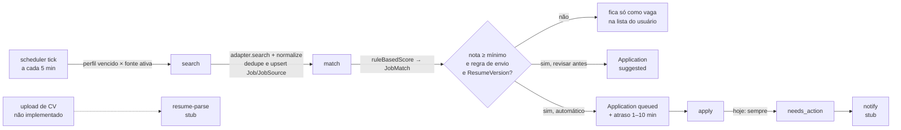

# Visão geral do CV Pilot

> Retrato do projeto em **2026-11-18**: o que já existe, como as peças se conectam e quanto do [PRD](PRD.md) está implementado.
> Para o que falta e o que melhorar, veja [melhorias.md](melhorias.md).

## 1. Em uma frase

O CV Pilot é uma plataforma para o candidato **configurar uma vez** o que procura e quais currículos usar em cada site. A partir daí, bots coletam vagas, dão uma nota de compatibilidade e preparam candidaturas automáticas ou assistidas, que o candidato acompanha num painel.

## 2. Estado atual (resumo)

O projeto está no fim da **Fase 0 (fundação)** do roadmap, com o esqueleto da Fase 1:

- O monorepo, os contratos, o banco, as filas, a infra Docker e o pipeline de workers estão de pé e bem organizados.
- Já há CRUDs e telas para os perfis de busca e as regras de envio (incluindo a precedência perfil+site → site → perfil → padrão, com testes).
- Três adapters de busca funcionam com APIs públicas: Gupy, Greenhouse e Lever.
- **Algumas peças centrais ainda são stubs.** O pipeline não gera candidaturas reais porque:
  - não há upload de currículo, então nunca existe uma `ResumeVersion` e o match para em "currículo sem arquivo";
  - o provedor de IA é um `NoopAiProvider`;
  - todo envio termina em "Ação necessária";
  - não há login (a API usa um usuário de desenvolvimento).
- Qualidade: `pnpm check` passa (typecheck, ESLint, knip e 6 testes). O `pnpm typecheck` isolado **falha num checkout limpo**, porque o Prisma Client ainda não foi gerado (ver [melhorias.md §1](melhorias.md#1-problemas-encontrados-no-código)); o `pnpm check` gera o client antes.
- Versionado em Git, com remoto no GitHub (`gabrielAlencar33564/cv-pilot`).

## 3. Arquitetura

### 3.1 Serviços

| Serviço | Tecnologia | Papel | Código |
|---|---|---|---|
| `web` | Next.js 15 (App Router) + Mantine 8 + TanStack Query | Interface do candidato | [apps/web](../apps/web) |
| `api` | Fastify 5 + Zod + Prisma | REST para o front e, no futuro, para a extensão | [apps/api](../apps/api) |
| `workers` | BullMQ + pino | Agendamento, busca, matching, envio, notificações, extração de CV | [apps/workers](../apps/workers) |
| `extension` | (planejada) Chrome MV3 | Modo assistido: preenche o formulário, e o candidato envia | [apps/extension](../apps/extension) |
| `postgres` | PostgreSQL 16 + pgvector | Dados relacionais e embeddings | [schema.prisma](../packages/db/prisma/schema.prisma) |
| `redis` | Redis 7 | Filas BullMQ | — |
| `s3` | SeaweedFS (gateway S3) | Arquivos de currículo | [s3-entrypoint.sh](../infra/docker/seaweedfs/s3-entrypoint.sh) |
| `caddy` | Caddy 2 | HTTPS e proxy (`/api/*` → api, resto → web) | [Caddyfile](../infra/docker/caddy/Caddyfile) |

### 3.2 Pacotes internos

| Pacote | Responsabilidade | Observação |
|---|---|---|
| [`contracts`](../packages/contracts/src) | Schemas Zod compartilhados (enums, perfil de busca, regra de envio, vaga normalizada) | Fonte única dos tipos. O `web` ainda duplica parte deles em [types.ts](../apps/web/src/lib/types.ts) |
| [`core`](../packages/core/src) | Regras puras: `resolveSendRule`, `jobDedupeHash`, `ruleBasedScore` | Sem dependência de framework |
| [`db`](../packages/db) | Schema Prisma, migrations, client único e seed | Migration inicial `20261118000000_init` |
| [`queue`](../packages/queue/src/index.ts) | Nomes das filas, tipos de payload, conexão Redis, `enqueue` | Retentativas: 4, backoff exponencial de 30 s |
| [`adapters`](../packages/adapters/src) | Um adapter por site + `createPoliteFetch` (User-Agent identificado, timeout, intervalo por host) | Gupy (busca por palavra-chave), Greenhouse e Lever (por empresa, via `Source.config`) |
| [`ai`](../packages/ai/src/index.ts) | Interface `AiProvider` (extração de CV, carta, embeddings) | Só `NoopAiProvider` |
| [`config`](../packages/config) | tsconfig base / node / next (strict, `noUncheckedIndexedAccess`, `noUnusedLocals`, `noUnusedParameters`) | ESLint e knip ficam na raiz ([eslint.config.mjs](../eslint.config.mjs), [knip.json](../knip.json)) |

### 3.3 Fluxo do pipeline



Pontos importantes:

- **Idempotência.** Os jobs usam ids determinísticos (`search_{perfil}_{fonte}_{janela}`, `match_{vaga}_{perfil}`, `apply_{candidatura}`).
- **Escala por fila.** Cada réplica escolhe o que consome via `WORKER_QUEUES`. No compose de produção, `workers-scheduler` roda `scheduler,notify` e `workers` roda `search,match,apply,resume-parse`.
- **Bloqueios.** O `politeFetch` lança erro em HTTP 403/429 e nunca tenta contornar o bloqueio. Os erros ficam em `Source.lastError`.

### 3.4 Modelo de dados

```
User ─┬─< SearchProfile ──< JobMatch >── Job ──< JobSource >── Source
      ├─< Resume ──< ResumeVersion (storageKey, parsed, embedding vector(1536))
      ├─< CoverLetterTemplate
      ├─< SendRule (sourceId?, searchProfileId?, resumeId, tom, modo, defaultAnswers)
      ├─< Application (job, source, resumeVersion, status, answers, log[])
      ├─< OAuthConnection (tokens criptografados — ainda não usada)
      └─< ConsentLog
```

Status de candidatura (`contracts/enums.ts`): `suggested`, `queued`, `needs_action`, `sent`, `in_process`, `interview`, `offer`, `rejected`, `no_response`, `failed`.

### 3.5 API REST atual

| Rota | O que faz |
|---|---|
| `GET /health`, `GET /health/ready` | Liveness e readiness (Postgres + Redis) |
| `GET /sources` | Fontes ativas |
| `GET/POST/PUT/DELETE /search-profiles`, `PATCH /search-profiles/:id/active` | CRUD de perfis de busca |
| `GET/POST /resumes` | Lista e cria currículos (só metadados) |
| `GET/POST/PUT/DELETE /send-rules`, `GET /send-rules/resolve` | CRUD de regras e qual regra vale para um site/perfil |
| `GET /jobs` | Vagas compatíveis, paginadas e ordenadas pela nota |
| `GET /applications`, `PATCH /applications/:id` | Painel e atualização manual de status/notas |

### 3.6 Telas atuais

Início · O que estou buscando · Currículos (sem upload) · Envio por site · Vagas (somente leitura) · Candidaturas (kanban somente leitura com 6 colunas).

## 4. Cobertura do PRD

Legenda: ✅ feito · 🟡 parcial · ❌ não iniciado

| Área (PRD) | Status | O que existe / o que falta |
|---|---|---|
| 3.1 Conta e perfil (RF-01–04) | ❌ | Bypass de dev via `x-dev-user-id`. Sem login, perfil, consentimento, exportação ou exclusão |
| 3.2 Perfis de busca (RF-10–12) | 🟡 | CRUD e pausar/retomar. Falta duplicar. O formulário não expõe contrato, salário, blacklist nem frequência |
| 3.3 Currículos (RF-20, 21, 24, 25) | 🟡 | Metadados e versionamento no schema. Falta upload, extração por IA e pré-visualização |
| 3.3 Regras por site (RF-22, 23) | ✅/🟡 | CRUD e precedência testada. Falta CRUD de modelos de carta e edição de `defaultAnswers` na UI |
| 3.4 Busca (RF-30–35) | 🟡 | 3 adapters, scheduler e dedupe. Falta expirar vagas (RF-34) e o admin de fontes (RF-35) |
| 3.5 Matching (RF-40–42) | 🟡 | Nota só por palavras-chave e regras básicas. Sem embeddings, "o que falta" e "não tenho interesse" |
| 3.6 Envio (RF-50–54) | 🟡 | Fila com atraso aleatório. Os modos API e e-mail não existem; assistido depende da extensão |
| 3.7 Painel (RF-60–63) | 🟡 | Kanban só leitura. Sem mudança de status na UI, sem notas e sem métricas |
| 3.8 Notificações (RF-70–71) | ❌ | Processor `notify` é stub |
| 3.9 Administração (RF-80–81) | ❌ | Só `Source.lastRunAt/lastError` |
| RNF-01/02 TypeScript strict, pnpm + Turbo | ✅ | Corrida no `generate` (ver melhorias) |
| RNF-03/04 Docker, serviços separados | ✅ | Multi-stage, `turbo prune`, cache mount, réplicas por fila. Falta `workers-browser` |
| RNF-05 LGPD | ❌ | `ENCRYPTION_KEY` definida, mas não usada |
| RNF-06 Conformidade com sites | 🟡 | UA identificado e intervalo por host. Falta `robots.txt` e limite global entre réplicas |
| RNF-07 Resiliência | 🟡 | Retentativas e jobs idempotentes. Sem DLQ visível nem alerta |
| RNF-08 Observabilidade | 🟡 | pino e health da API. Workers sem healthcheck nem métricas por adapter |
| RNF-10 Testes | 🟡 | 6 testes unitários (core + gupy). Sem testes de API, e2e nem CI |

## 5. Como rodar

```bash
pnpm install
cp .env.example .env
pnpm infra:up        # Postgres :5433, Redis :6380 e S3/SeaweedFS :8333
pnpm db:deploy       # aplica as migrations versionadas
pnpm db:seed         # fontes + usuário dev
pnpm dev             # web :3000, api :4000, workers
```

Para que o Greenhouse e o Lever encontrem vagas, preencha `Source.config` (`{"boards": [...]}` e `{"companies": [...]}`). O seed não faz isso.

Verificação completa: `pnpm check` (Prisma generate, typecheck, lint, knip e testes).
